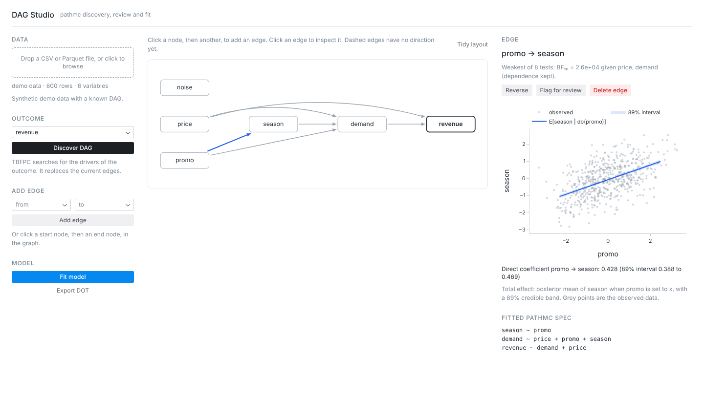

# DAG Studio

A minimal [Reflex](https://reflex.dev) front end for
[pathmc](https://pathmc.pymc-labs.com). Upload a dataset, let pathmc's `TBFPC`
propose a causal graph, edit it by hand, flag what needs a second look, and see
each fitted relationship as a plot.



## What it computes

**Discovery.** For each pair, TBFPC tests `Y ⊥ X | S` by comparing two linear
models, `M0: Y ~ S` and `M1: Y ~ S + X`:

    BIC(M)     = n · log(RSS / n) + k · log(n)
    log BF10   ≈ −½ · [BIC(M1) − BIC(M0)]

- `n`: rows. `RSS`: unexplained variation in `Y`. `k`: number of coefficients.
- `BF10`: how much more the data support "X matters" than "X adds nothing given S".
- The edge is dropped when `BF10 < 1`.

The edge panel shows the *weakest* `BF10` found for that pair and the
conditioning set that produced it.

**Fitted relationship.** After a fit, selecting an edge `X → Y` plots

    E[ Y | do(X = x) ]   with an 89% credible band

- `do(X = x)`: X is set to x by intervention, not merely observed at x.
- The curve is the **total** effect of X on Y through every directed path in
  your graph.
- Grey points are the observed data.

Below the plot is Y's **fitted equation**, with posterior means and 89%
intervals:

    Y = b0 + b1 · X + b2 · Z + ε,   ε ~ Normal(0, σ)

The X term is highlighted: it is the **direct** effect of the edge, so you can
see when it differs from the total effect in the curve.

## Run it

Requires Python 3.12+ and [uv](https://docs.astral.sh/uv/).

```bash
uv sync
uv run reflex run
```

Open http://localhost:3000. The first start takes a minute while Reflex builds
the front end. Use **Load demo data** to try it without a file.

## Using it

1. **Upload** a CSV or Parquet file. Numeric columns become nodes; non-numeric
   and constant columns are ignored, and rows with missing values are dropped.
   The left panel lists exactly what was changed.
2. **Pick the outcome** and press **Discover DAG**. Dashed edges are ones the
   data cannot orient.
3. **Edit the graph.**
   - Add an edge with the two **Add edge** dropdowns in the left panel.
     Doing this on an existing edge re-points it. Clicking nodes only
     selects them; it never adds an edge.
   - Select an edge by clicking it: reverse it, give a dashed edge a
     direction, flag it, or delete it.
   - Select a node by clicking it: flag it for review or remove it. Removed
     nodes appear as chips in the left panel and can be put back.
   - Edits that would create a cycle are refused.
4. **Fit model** once every edge has a direction. This runs MCMC through
   pathmc and takes roughly 10 to 60 seconds.
5. **Click any edge** to see its fitted relationship and the fitted equation
   of its end node on the right.
6. **Export DOT** saves the graph, with flagged items listed as comments. The
   file can be passed straight to `pathmc.dag_to_spec`.

After any structural edit the plot is hidden and the button reads **Refit
model**, so a plot never describes a graph that is no longer on screen.

## Manual testing

The left panel has **Load test file** and **Download test file** links for
`assets/dag_studio_test_data.csv`, a messy dataset with a known structure.
Loading it uses the same cleaning as an upload; downloading it lets you try the
drop zone too. Things to check:

- **Cleaning notes** list: `region` ignored (text), `tax_rate` ignored
  (constant), four columns renamed (`2024 price index` → `v_2024_price_index`),
  15 rows dropped for missing `web_visits`.
- **Discover DAG** (outcome `revenue`) draws four layers top-down, from
  `ad_spend`/`season`/`v_2024_price_index` down to `revenue`. `noise` stays
  unconnected and the long `customer_satisfaction_score` label is shortened.
- `season — store_visits` comes back dashed: orient it with **Keep direction**.
- Discovery misses the real `v_2024_price_index → revenue` effect: add it by
  hand, then try `revenue → ad_spend` to see the cycle check refuse it.
- Click a node, type a description, hover the node to see it, then
  **Export DOT** and look for the `tooltip` attribute.
- **Fit model**, then click `orders → revenue`: the equation appears at once,
  with the `orders` term highlighted and near 0.9. Edit any edge and it hides
  until you refit.

The file is generated by `backend.test_file_table()`; a test fails if the two
drift apart.

## Layout of the code

| File | Role |
|---|---|
| `dag_studio/backend.py` | Data loading, TBFPC, layout and edge routing, fitting, curves. No Reflex imports. |
| `dag_studio/state.py` | Reflex state and event handlers. |
| `dag_studio/dag_studio.py` | The page: three panels and the SVG graph. |
| `tests/test_backend.py` | Backend tests, including recovery of known effects from synthetic data. |

Settings such as the MCMC budget, the Bayes-factor threshold and the interval
width are constants at the top of `backend.py`.

```bash
uv run pytest                 # everything (~30 s, includes one MCMC fit)
uv run pytest -m "not slow"   # skip the MCMC test
```

## Limits to know about

- **Linear, Gaussian, numeric only.** Both discovery and the fitted model are
  linear. A purely nonlinear dependence can be missed, and the plotted curve
  will always be a straight line.
- **Discovery is target-first.** TBFPC searches for drivers of the chosen
  outcome. It is not a symmetric whole-graph search, and pathmc marks it
  experimental.
- **No edge-stability estimate.** The Bayes factor is from one pass over the
  data; there is no bootstrap.
- **Single user, in memory.** The dataset and fitted model live in the server
  process, keyed by browser tab, and are lost on restart. This is a local
  tool, not a hosted service.
- **pathmc is pre-1.0.** The dependency is pinned to `0.6.x`.
- Node positions are computed, not draggable. **Tidy layout** recomputes them.
